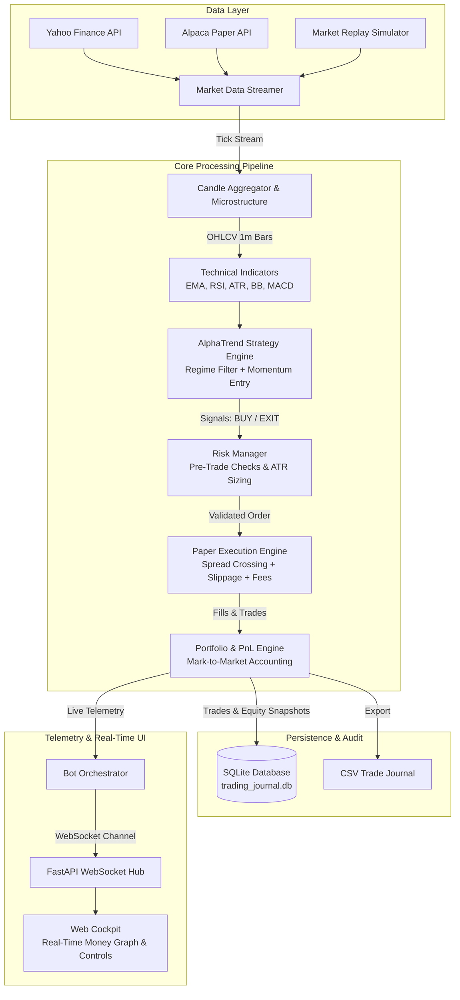

# AlphaPulse: End-to-End Algorithmic Paper-Trading System


**AlphaPulse** is an enterprise-grade, event-driven algorithmic paper-trading bot designed for index ETFs (e.g., S&P 500 `SPY`, Nasdaq 100 `QQQ`, Dow Jones `DIA`, Russell 2000 `IWM`) and 24/7 crypto markets. It features a quantitative trend-and-momentum strategy, dynamic ATR risk management, realistic market microstructure execution (bid-ask spread crossing, adverse slippage, and commissions), SQLite/CSV audit persistence, and an interactive **Real-Time Money Graph (Equity Curve) Web Cockpit**.

---

## 🌟 Key Features

### 1. 📡 Multi-Provider Data Ingestion
- **Real-Time Streaming & High-Frequency Polling**: Streams live quotes via **Yahoo Finance FastInfo**, **Alpaca Markets Paper Trading API**, or a high-fidelity **Market Replay Simulator**.
- **Historical Priming**: Automatically downloads and warm-starts indicators with up to 1,950+ 1-minute historical candles upon launch.
- **Intraday Candle Aggregator**: Continuously aggregates ticks into real-time 1-minute OHLCV candles without data loss.

### 2. 🧠 AlphaTrend v2: Trend-Filtered Pullback Strategy
A short-term mean-reversion edge inside an established uptrend, decided **once per day shortly before the close** (using the live price as the provisional daily close). Full rationale and evidence are in [Strategy research](#-strategy-research--backtest-results).

| Rule | Default (`config.py`) |
| :--- | :--- |
| **Regime** | Daily close > SMA(200) → longs only (below it the bot stays flat) |
| **Entry** | Daily RSI(2) < 10 – a washed-out pullback inside the uptrend |
| **Exit** | Daily close back above SMA(5), or a 10-trading-day time stop |
| **Protection** | Wide crash-insurance stop at 5 × daily ATR(14), checked on every tick (this stop also drives position size) |
| **Shorts** | Opt-in (`allow_shorts=true`): RSI(2) > 90 below the SMA(200), cover under the SMA(5) |

Use `--strategy legacy` (or `ALGO_STRATEGY_NAME=legacy`) to run the previous intraday EMA/RSI/MACD strategy for comparison. The bot loads ~2 years of daily bars at startup, keeps extending them from the live intraday stream, and handles crypto (`BTC-USD`) on the 24/7 UTC day.

> **Expect a quiet bot.** The strategy trades ~8 times per year per symbol, holds ~3 days and is invested ~11% of the time. The dashboard shows `Flat; next decision at 15:45 market time (RSI(2)=…)` most of the day – that is by design.

### 3. ⚙️ Realistic Execution Engine (Microstructure Simulation)
- **Bid-Ask Spread Crossing**: Market BUY orders execute against Ask (`Mid + Half-Spread`), while SELL orders execute against Bid (`Mid - Half-Spread`).
- **Adverse Slippage Modeling**: Linear market-impact slippage model with stochastic queue-depth noise (`1.5 bps base + random variance`).
- **Commissions & Exchange Fees**: Simulates realistic retail/broker fee structures ($0.005/share, $1.00 minimum).
- **Cash Solvency & Sizing Safeguards**: Prevents negative cash balance and rejects unfillable orders.

### 4. 🛡️ Enterprise Risk Management & PnL Tracker
- **Volatility-Based Position Sizing (Risk Parity / Fractional Kelly)**:
  $$\text{Shares} = \min\left(\frac{\text{Equity} \times \text{Risk\%}}{\text{Entry} - \text{StopLoss}}, \frac{\text{Equity} \times \text{MaxCap\%}}{\text{Entry}}, \frac{\text{Cash}}{\text{Entry}}\right)$$
- **Concentration Limit**: Caps any single position at 30% of total portfolio equity.
- **Daily Loss Circuit Breaker**: Halts trading automatically if portfolio equity drops more than 4% from the day's open.
- **Max Drawdown Protection**: Emergency trading freeze if maximum drawdown breaches 10%.
- **Live Statistical Risk Metrics**:
  - High Water Mark & Real-time Drawdown ($ and %)
  - Win Rate (%) & Profit Factor ($\frac{\text{Gross Profit}}{\text{Gross Loss}}$)
  - Annualized Sharpe Ratio and Sortino Ratio (downside risk)

### 5. 💾 Persistence, Audit Trails & CSV Export
- **SQLite Database** (`trading_journal.db`):
  - `trades`: All completed round-trip trades with entry/exit prices, timestamps, fees, slippage, net PnL, return %, and exit reasons.
  - `orders`: Granular record of every submitted order and fill state.
  - `equity_history`: Historical snapshots of cash, portfolio equity, and drawdowns.
  - `system_logs`: Audit logs of all strategy signals, risk checks, and system events.
- **One-Click CSV Export**: Download the entire journal directly from the UI or via `/api/export-csv`.

### 6. 📈 Real-Time Money Graph & Web Dashboard ("Tell the Graph Realtime of the Money")
- **Live WebSocket Telemetry**: Sub-second push channel updating the UI without polling.
- **Interactive Real-Time Equity Curve**:
  - Visualizes Portfolio Equity ($) against Available Cash ($) and High Water Mark in real time.
- **Live Price & Indicator Canvas**:
  - Real-time price chart with EMA 9, EMA 21, Bollinger Bands, and dynamic Buy/Sell trade execution markers.
- **Active Position HUD**:
  - Live unrealized PnL badge, Stop-Loss line, Take-Profit target, and Emergency "Close Position" button.
- **Interactive Control Cockpit**:
  - Start / Pause / Resume Bot
  - Switch Index Symbol (`SPY`, `QQQ`, `DIA`, `IWM`, `BTC-USD`)
  - Switch Data Feed (`High-Fidelity Replay`, `Yahoo Live Polling`, `Alpaca Paper API`)
  - Speed Multiplier (`1x`, `2x`, `5x`, `10x`)
  - Manual Paper Buy / Sell Order execution
  - Reset Portfolio to baseline $100,000

---

## 🏛️ System Architecture



---

## 🚀 Quickstart & Installation

### 1. Requirements
- Python 3.10+ (Tested on Python 3.14)
- Internet connection (for live data feeds from Yahoo Finance / Alpaca)

### 2. Install Dependencies
```bash
pip install -r requirements.txt
```

### 3. Run the Trading Cockpit
```bash
python run.py
```
By default, the server starts on `http://127.0.0.1:8000` with **SPY (S&P 500 ETF)** and **High-Fidelity Replay Mode** enabled.

### 4. Custom CLI Options
```bash
# Run with Nasdaq 100 ETF at 5x simulation speed
python run.py --symbol QQQ --speed 5.0

# Run with Yahoo Live Polling on Dow Jones ETF
python run.py --symbol DIA --mode yahoo

# Run with custom port and initial capital
python run.py --capital 250000 --port 8080
```

---

## 📊 Strategy Research & Backtest Results

**Method.** `backtest.py` replays historical bars as intrabar ticks through the *real* `BotOrchestrator` – the same strategy, risk manager, spread/slippage/commission model (1 bp half-spread + 1.5 bps slippage per side + commissions ≈ 5.5 bps round trip) and portfolio accounting used live. Bars are walked adverse-extreme-first, so a stop and a target inside one bar resolve against us. Data: Yahoo Finance, split/dividend-adjusted.

**1. The previous strategy lost money.** Intraday EMA/RSI/MACD pullbacks, 60 days of 5-minute SPY: 248 trades, 28.6% win rate, **profit factor 0.24**, −6.5 bps per trade, Sharpe −15 (buy-and-hold: +4.6%). Its 0.85 ATR stop / 1.25 ATR target on 1-minute bars was about the size of the round-trip cost, so costs alone ate the edge.

**2. No intraday momentum edge exists at this cost level.** `research/intraday_screen.py` screened trend-pullback, Donchian-breakout and VWAP-reversion families (5- and 15-minute bars, several stop/trail settings) on SPY/QQQ/IWM/DIA. Trend and breakout variants lost money on *every* symbol (average −5 to −9 bps/trade, profit factor 0.5–0.7). VWAP reversion lost on 5-minute bars (about −4 to −5 bps/trade) and was merely break-even on 15-minute bars.

**3. A slower edge survives costs.** `research/daily_screen.py` and `research/daily_robustness.py` test daily pullbacks over 26–33 years. The canonical rule (RSI(2) < 10 above the 200-day SMA, exit above the 5-day SMA) is positive on all four ETFs and in every sub-period tested (since 2010, 2018, 2021, 2024), even when entering at the *next open*. No parameter tweak helped every ETF, so the defaults are the textbook values rather than curve-fitted ones. Tight stops hurt this trade family, hence the deliberately wide stop.

**4. The shipped code reproduces it end to end.** `python backtest.py --symbols SPY QQQ IWM DIA --since 2003-01-01` (daily replay, 2003-2026, default sizing: 1.5% risk, 30% cap):

| ETF | Trades | Win % | Profit factor | Avg net / trade | Max drawdown | PF 2003-14 → 2014-26 |
| :--- | ---: | ---: | ---: | ---: | ---: | :--- |
| SPY | 197 | 75.1 | 2.14 | +46 bps | 2.7% | 2.12 → 2.15 |
| QQQ | 209 | 69.4 | 1.66 | +42 bps | 4.8% | 1.93 → 1.50 |
| IWM | 188 | 71.8 | 1.41 | +32 bps | 6.8% | 1.76 → 1.11 |
| DIA | 209 | 72.2 | 1.41 | +21 bps | 3.9% | 1.33 → 1.48 |

Replaying 2.9 years of *hourly* bars through the live code path (`--interval 1h --period 730d --set decision_lead_minutes=30`) is also profitable on all four (profit factor 1.7–4.4, ~30 trades each), but that window was a bull market, so treat it as a plumbing check rather than extra proof.

**Honest caveats**
- **Low capital efficiency.** At default sizing the bot is ~30% invested for ~11% of the time, so the account grows only about 1% per year (SPY: +25% over 23 years) – far below buy-and-hold (SPY +1,250% over the same period). This is a low-risk *alpha satellite*, not a replacement for holding the index. Sizing scales returns and drawdown together: `--set risk_per_trade_pct=0.04 --set max_position_size_pct=1.0` made SPY +89% (9% max drawdown) but pushed QQQ and IWM past the 10% emergency drawdown halt, which stops trading.
- **Edge is decaying/uneven.** IWM's later half (PF 1.11) and QQQ's (1.50) are weaker than their earlier halves. Expect lumpy results; a drawdown of several percent is normal.
- **Shorts are opt-in** because the evidence is mixed: positive on SPY/IWM/DIA, a net loser on QQQ (−$2.4k over 46 trades).
- **Paper only.** Fills are modelled, not real; the decision uses the ~15-minutes-before-close price, which will differ from the official close. Results come from one historical path and are not a forecast.
- **Diversify to scale.** The research shows the edge on SPY, QQQ, IWM, DIA and BTC-USD; the practical way to deploy more capital without more risk per trade is to run several symbols (the bot is currently one symbol per process).

```bash
python backtest.py --symbols SPY QQQ IWM DIA --since 2003-01-01 -v       # the table above
python backtest.py --symbols SPY --since 2003-01-01 --split 0.5          # earlier half vs later half
python backtest.py --symbols SPY --interval 5m --period 60d --strategy legacy -v   # old strategy benchmark
python backtest.py --symbols SPY --set allow_shorts=true                 # any config field can be overridden
```

---

## 🧪 Automated Test Suite

AlphaPulse includes a comprehensive test suite covering indicators, execution microstructure, risk controls, strategy rules, and live REST/WebSocket endpoints.

```bash
# Run all unit and integration tests
python -m pytest tests/test_trading_system.py tests/test_bidirectional_and_replay.py tests/test_strategy_v2.py -v

# Run live server and REST endpoint verification
python tests/test_server_live.py

# Run live WebSocket streaming verification
python tests/test_ws.py
```

---

## 📊 REST & WebSocket API Reference

| Method | Endpoint | Description |
| :--- | :--- | :--- |
| `GET` | `/` | Web Dashboard Cockpit UI |
| `GET` | `/api/state` | Full system state (equity, position, metrics, latest tick) |
| `GET` | `/api/trades` | Historical closed trades journal |
| `GET` | `/api/equity-history` | Time-series data points for the real-time money chart |
| `GET` | `/api/logs` | Recent audit and trade execution logs |
| `GET` | `/api/export-csv` | Download trade journal as a formatted `.csv` file |
| `POST` | `/api/control/start` | Start or resume bot |
| `POST` | `/api/control/pause` | Pause trading execution |
| `POST` | `/api/control/resume` | Resume trading execution |
| `POST` | `/api/control/symbol` | Switch active symbol (`{"symbol": "QQQ"}`) |
| `POST` | `/api/control/mode` | Switch data feed (`{"mode": "yahoo"}`) |
| `POST` | `/api/control/speed` | Set replay speed (`{"speed": 5.0}`) |
| `POST` | `/api/control/reset` | Reset portfolio to $100,000 baseline |
| `POST` | `/api/control/close-position`| Emergency flatten / close open position |
| `POST` | `/api/control/manual-order` | Submit manual order (`{"side": "BUY", "quantity": 25}`) |
| `WS` | `/ws` | High-frequency bidirectional WebSocket stream |

---

## 🛡️ Risk Management Parameters (`config.py`)

All risk and execution parameters can be adjusted via `config.py` or `.env` file:

```python
risk_per_trade_pct = 0.015       # Risk 1.5% of total equity per trade
max_position_size_pct = 0.30     # Max 30% capital allocation per position
max_daily_drawdown_pct = 0.04    # 4% daily loss circuit breaker
max_drawdown_limit_pct = 0.10    # 10% emergency halt threshold
half_spread_bps = 1.0            # 1.0 bp half-spread (0.01%)
base_slippage_bps = 1.5          # 1.5 bps adverse market impact slippage
commission_per_share = 0.005     # $0.005 per share commission ($1 min)

# AlphaTrend v2 strategy
strategy_name = "alphatrend_v2"  # or "legacy"
trend_sma_period = 200           # regime filter (daily)
pullback_rsi_entry = 10.0        # daily RSI(2) entry threshold
exit_sma_period = 5              # exit when price closes back above this daily SMA
max_hold_days = 10               # time stop
disaster_stop_atr_mult = 5.0     # wide crash-insurance stop (also sets position size)
allow_shorts = False             # opt-in mirror-image short side
decision_lead_minutes = 15       # decide once per day this long before the close
```
(`atr_stop_loss_mult` / `atr_take_profit_mult` now only affect the legacy strategy and the dashboard's manual orders.)

---

## 📝 License
MIT License. Created for quantitative research, algorithmic trading education, and high-frequency strategy design.
# sloopy-trading-systen

